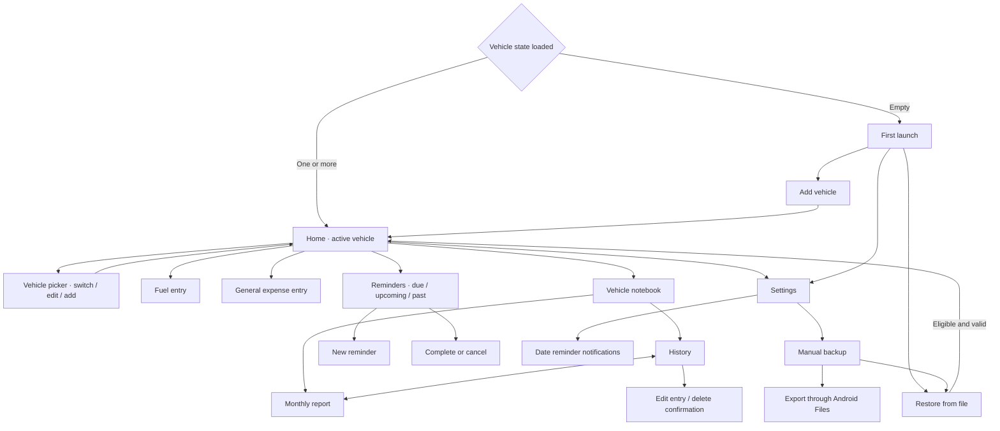
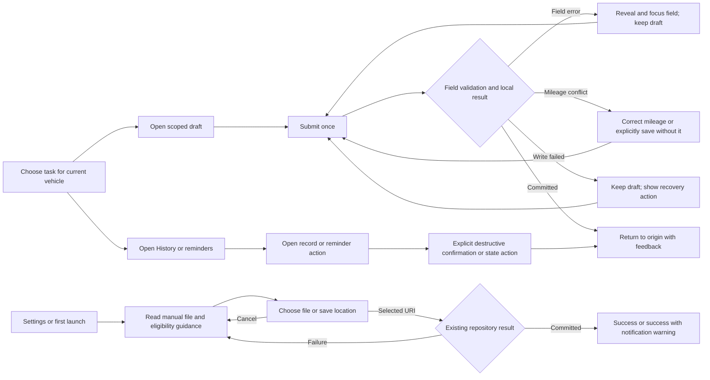

# Vehicle Ledger · Product UX proposal

**Status: proposed for owner review · 2026-11-16**

## Evidence and diagnosis

Reviewed [project instructions](../../AGENTS.md), [handoff](../../HANDOFF.md), [execution record](../../PLANS.md), [roadmap](../../docs/delivery/ROADMAP.md), [MVP scope](../../docs/product/MVP_SCOPE.md), [Bazaar readiness](../../docs/delivery/BAZAAR_RELEASE_READINESS.md), the [data design](../../docs/architecture/DATABASE_DESIGN.md), the Compose routes, screens, theme, strings and their state and repository boundaries. The [previous UX audit](</home/amir/.gemini/antigravity/brain/24a527bc-3dcd-49df-a31e-6cfe2d48e738/VEHICLE_LEDGER_DESIGN_SYSTEM_AND_UX_AUDIT.md>) provides historical context. The current owner brief supersedes the approval language in HANDOFF and PLANS for that design. Git reports an unborn branch and the existing tree as untracked. Current source observations are attributable to this working tree. Signed RC5 behavior and upgrade evidence come from the retained [RC5 release record](../../docs/delivery/ANDROID_RELEASE.md#populated-redmi-rc5-upgrade-pass). Current source and RC5 are distinct evidence.

Three local signed RC5 screens informed the direction. Home has useful vehicle and odometer context but gives multiple actions similar weight. History dedicates a full action row and container to each entry, slowing financial scanning. Report confirms the value of an exact headline total and category detail. Its relationship to History is weak when routes can be opened from several places with different return paths. The current Compose redesign compresses some controls and groups, but retains the generic entry route, overlapping History/report entry points, a clustered Home selector and stacked Home actions, and a creation form above reminder management. Current Quick Add already defaults to fuel. The proposed fuel shortcut changes the choice the driver sees, not the amount/volume requirements or the already-direct path for drivers who accept that default.

Evidence surfaces: [RC5 Home](../../build/redmi-rc5-upgrade.ZOWcjD/rc5-offline-home.png), [RC5 History](../../build/redmi-rc5-upgrade.ZOWcjD/rc5-offline-history.png), [RC5 Report](../../build/redmi-rc5-upgrade.ZOWcjD/rc5-offline-aban.png).

### Capability boundaries

| Scope | Evidence and implication |
|---|---|
| Existing offline behavior | Manual vehicle add/edit, expense and service capture, entry correction/delete, linked odometer capture, latest mileage, per-vehicle exact monthly report, user-created reminders, opt-in date notifications, manual file backup and atomic restore into an empty ledger. |
| Multiple vehicles | Current Home can switch persisted vehicles in memory, although the project scope retains multi-vehicle UI as deferred. The A–N visuals include a shell for this already present selector as requested. Keep a one-active-vehicle workflow. Broader fleet management and persistent default selection need separate decisions. Confirm shipping visibility at review. |
| Odometer only | Standalone readings are part of repository and backup contracts. Current Compose routes only collect mileage through an expense/service; standalone readings have no create/edit/delete app route and are excluded from the expense History query. Preserve them in latest mileage and backup; no standalone action in the base prototype. |
| Vehicle catalog | Optional integration behind missing approved asset. Manual setup is the base design. No plate, photo, required catalog or VIN. |
| Cloud | Conditional synthetic-development UI exists. RC5 disabled it. The proposed offline UI has no cloud control or teaser. If encountered via a future guarded route, use «بازیابی آنلاین در این نسخه در دسترس نیست.» and offer «بازیابی از فایل» where appropriate. |
| UX-only proposal | Change route hierarchy and placements, label fields by purpose, disclose optional entry fields, group and align read-only financial rows, use existing forms and results in new visual shells. Explicitly approved behavior-change candidates are listed in [Antigravity handoff](ANTIGRAVITY.md#owner-decisions). |

## Reference study

The developer pages and listings inform design patterns. The proposal uses the current ledger fields and actions.

- **Fuelio** puts a fill-up on its own form. I grouped the two required numbers, amount and liters, while keeping the editable date and optional mileage in view order. [Fuelio Fuel Log](https://www.fuel.io/en-US/features/fuel-log/)
- **Drivvo** shows fuel, expenses and services together in a chronological History. I used a Jalali day rail and put two records on Home using existing per-vehicle data. [Drivvo History](https://www.drivvo.com/en/about/)
- **Mechanist** makes the distance or time to service easy to read. I surface the due date on Home and show remaining kilometers for an existing mileage reminder only when there is a known reading and a positive difference. The app keeps its single threshold per reminder. [Mechanist product walkthrough](https://mechanist.ir/)
- **CarKeep — logs & reminders** by 家芳 陶 separates outstanding service from completed history and presents the local-only workflow up front. I used a clear due section and quieter closed statuses, and kept local backup visible during setup. Several products share the CarKeep name. [CarKeep developer listing](https://apps.apple.com/us/app/carkeep-logs-reminders/id6821856865)

## Information architecture

Use a **vehicle-first Home** and shallow drill-in. Fuel and other costs open the appropriate form directly. The vehicle readout carries name and latest recorded mileage in one place. A due service appears after quick entry, only when present. Two recent records link through their section to the vehicle notebook, which has History and Report as siblings. Reminders remain a separate operational list. Settings is app-wide and always reachable on Home, including the empty state. Manual recovery is also offered on first launch, before adding a vehicle. Export applies to the complete ledger.

A permanent bottom bar would devote space to actions with very different frequencies and compete with the IME and Save. Home already supplies the small set of task entrances and restores their context when users go Back. Notebook siblings remain one touch apart. An extra Home-to-Report and Home-to-History entry is deliberate: it lets the driver seek either destination by name, and both land in the same notebook.

### Back and context rules

- Home is the root. System Back and up-arrow resolve the same destination within the app after the IME, picker or dialog consumes Back. History and Report replace the notebook subview in place. Back from either returns to the originating Home instead of stepping through tab history.
- Exiting View or Edit returns to the original History record position. Opening from Home or an empty History returns to that origin. Quick Add and all details pin vehicle ID when opened. Scope changes invalidate old mileage, reminder and report content until the new scope loads.
- Back from recovery returns to the explicit caller, either manual backup or first launch. Restore success offers «رفتن به دفتر خودرو». A valid empty snapshot can return to the empty state. Canceling the Android picker stays on the current action screen with no success notice.
- Sheet dismissal restores focus to its opener. Returning from forms restores focus to the action or row. After deletion, focus the next retained item or list heading. Use Android system Back plus visible right-pointing «بازگشت». Keep proposals about unsaved-draft prompts and process-death retention gated.

## Journey map

| Journey and goal | Current entry, steps and friction | Proposed steps | Edge cases and recovery |
|---|---|---|---|
| 1. Start with a vehicle | Empty vehicle list → add → name/optional year and calendar → save. A generic list shell hides the returning-driver path. | Empty Home gives one primary action. Name first, calendar appears when year is entered. Restore is independently visible. | Trim and validate name via existing input. A nonzero four-digit year requires explicit calendar. Retain draft on save failure; retry the load separately. |
| 2. Switch vehicles | Home selector and active summary, then repeat the target action. Duplicate vehicle treatment can obscure the active scope. | Open the vehicle name → choose in a single sheet → return to freshly scoped Home. Add/edit accessible in sheet with readable names. | Long/mixed names and duplicate names. Use ID for selection; render year if present, never invent identifiers. Disable stale controls during scope transition where necessary. |
| 3. Log fuel | Home → generic Add (fuel default) → amount, volume, date, optional fields → save. The driver still sees a category decision and optional field clutter. | Home «ثبت سوخت» → amount and liters → confirm today’s visible Tehran date → optional mileage if needed → «ثبت سوخت». | Required positive amount and liters; preserve exact supported precision. Inline errors, IME-safe action, no duplicate writes, repair or explicitly omit a conflicting reading. |
| 4. Log maintenance and other expenses | Home → generic Add → change category → review inputs → save. Categories imply different amount requirements. | Home «ثبت هزینه» → choose category → amount and date → details when needed → save. No fuel volume in the general-entry form. | Blank amount allowed only for oil, repair and parts. Category changes preserve applicable inputs and existing repository handling of fuel volume. Missing amount appears as «بدون مبلغ». |
| 5. Record odometer | Enter as optional mileage on an expense/service. Latest mileage is on Home; no standalone route. | Expand «کارکرد و یادداشت» → use nearby latest reading as reference → enter actual kilometers → save transaction. | Reference is never auto-filled. Backdated reading may have earlier and later bounds. Empty edit keeps a linked value; explicit removal is reversible in the draft until Save. Mileage-only workflow is gated. |
| 6. Review, edit or delete | Open History → scan card payload and per-row actions → edit or confirm deletion. Repeated buttons compete with values. | Notebook History → scan date-grouped rows → open a row into edit → save, or open separate delete confirmation. | Keep list and position while opening. If legacy/unknown entry cannot open, retain row and existing supported actions. Linked removal warning precedes destructive commit. Recover stale entry or read failure without blanking the list. |
| 7. Understand monthly cost | Home or History → Report → picker → exact total and categories. Multiple route stacks obscure “back”. | Go straight to Report or select it in Notebook. Read month → exact total → priced category detail and unpriced count. | Month picker uses only the source’s available months. Distinguish empty month from zero known amounts and report failure. Keep preserved nonconvertible dates in a visible exception group with original stored date. |
| 8. Create or act on reminders | Home → reminders, with creation controls occupying first part of the screen. Active actions repeat in list. | Show due, upcoming, and past first. «ثبت یادآور» opens form. Active row opens complete/cancel choices. The due strip leads to the due group. | Date and mileage threshold rules unchanged. No mileage → stay active with explanation. Completed and canceled stay distinguishable. Date notification opt-in stays independent of in-app due status. |
| 9. Export local backup | Settings → choose save location → result. Dense copy precedes two operations competing on one page. | Settings → manual backup → export explainer → Android save picker → outcome. State scope, timing and readable file before handing off. | Cancel, unavailable provider, size limits, snapshot/DB validation and partial provider file. Show success only after write/close returns; failed attempt may leave unusable file at provider. |
| 10. Restore empty install | Empty or populated settings → choose file → repository checks. Eligibility text is easy to miss and setup can happen first by habit. | First launch → «بازیابی از فایل» → clear empty-ledger explanation → Android open picker → actual result. Same path accessible from Settings. | Repository eligibility checks all tables and rechecks at atomic commit. Populated target stays intact. Unsupported/invalid/oversize/file unavailable each receives clear guidance. Empty valid snapshot, canceled picker and notification warning handled independently. |
| 11. Recover from errors | Errors and retries scattered or temporary; asynchronous load can resemble missing content. | Field-local error plus focus; durable inline notice for blocked or failed action; loading shape occupies final slot. Show confirmed success in origin. | Visible distinction between unknown/load failure/empty. Preserve existing data and draft. The view must never label a failed in-app write as committed; carry partial post-commit reminder cleanup warning. |
| 12. Handle cloud unavailability | RC5 flag off. Local development has a separate gated experimental path. | Offline Settings presents manual recovery only. If a guarded stale route is ever retained, offer the unavailability notice and backup link. | Airplane mode is normal. Future gated recovery remains last acknowledged snapshot and empty-target restore. Transfers, account association, and deletion get explicit approval and separate design. |

## Design review

| Criterion | Tradeoff or weakness to test |
|---|---|
| Ease of learning | Home uses named tasks and one current vehicle. Some drivers may expect to change vehicle from deeper screens. We keep forms pinned and provide Back to selector. |
| Frequent entry speed | Fuel avoids category selection; prefilled date reduces typing. Optional mileage adds a disclosure tap. Timing and first-attempt completion remain unverified with actual drivers. |
| Financial clarity | End-aligned exact values and explicit unpriced count simplify comparison. A very long exact value can wrap onto a second line. Bars communicate rough relative magnitude only. |
| Persian RTL | Persian labels and digits, localized units, and bidirectional isolation are represented. MIUI and alternative Persian IMEs can behave differently, especially while editing slashed dates. |
| Navigation predictability | One notebook stack and explicit origins. Switching the notebook tab will require a deliberate choice about scroll retention per tab, specified in handoff. |
| Visual originality | The dark odometer readout anchors the first viewport. The day rail helps date scanning but reduces room for notes and amounts, so the exact amount stacks beneath the description at large text. |
| Density | A scan row omits a second inline action and some details. The driver must open a record to read all data or delete. |
| 150% text | Stacked actions and wrapping preserve content. A short display with open IME may show one error at a time; scroll stability matters. Browser text scaling is visual evidence only. |
| Feasibility | Existing Flow and repository contracts suffice for base views. The route shell, cross-route focus restoration and compact form footer are the main engineering risks. |
| Consistency | Same edge rules, typographic roles and action priorities across sections. Warning bands and report bars need a parity check against the same token roles. |
