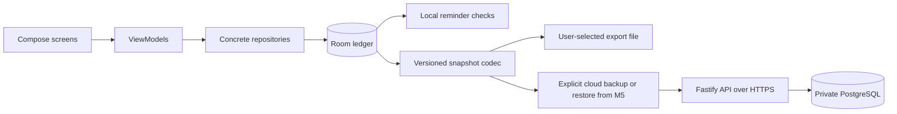

# System architecture

## Android application

Use one `:app` Gradle module with Kotlin and Jetpack Compose Material 3. Home, History, Vehicle, Reminders, and Settings use screen-level ViewModels with `StateFlow`. Concrete repositories own data access and transactions. `AppContainer` constructs dependencies. Use ordinary Kotlin for deterministic rules and platform APIs for Android integration.

- **M1–M4:** The driver uses the app offline without an account. The Android app owns the vehicle, ledger, dashboard, reminders, and file backup.
- **M5:** Optional recovery uses one small TypeScript and Fastify API and PostgreSQL. The backend owns account authentication, conditional snapshot storage, and recovery. The server stays outside the logging and reporting path.
- **M6:** One eligible production host runs the API behind TLS with private database access. Use isolated staging, redacted logs, uptime checks from the pilot market, and encrypted off-host backups. Verify a restore before distribution.

## Recovery boundaries

Manual file backup is an explicit export through the Android file picker. The driver must retain the file. It does not run automatically. The file contains records from export time. A later local change requires another export to appear in a recovery file.

Cloud recovery restores the last acknowledged snapshot. It does not run as real-time multi-device synchronization or merge edits. An offline device can continue logging. A stale cloud write leaves the server snapshot and local ledger intact. Restore only into an empty ledger after validation. Exclude the ledger and session material from Android automatic backup and device transfer rules, and verify the effective rules on a supported device.

Keep session tokens in Keystore-protected, non-backed-up storage. Use app-private Room storage for the ledger. Keep the signing key, provider credentials, record contents, and account secrets out of source and logs. Use separate, explicit controls for local erasure and cloud account deletion. [Recovery ADR](ADR/0002-recovery-boundaries.md), [Android backup rules](https://developer.android.com/identity/data/autobackup)

## Decision records

- [ADR 0001 · Android and Room](ADR/0001-android-and-room.md)
- [ADR 0002 · Recovery boundaries](ADR/0002-recovery-boundaries.md)
- [ADR 0003 · Signed APK distribution](ADR/0003-signed-apk-distribution.md)
- [ADR 0004 · Cloud recovery security and custody](ADR/0004-cloud-recovery-security.md) (Option A approved for the limited pilot)

See [data design](DATABASE_DESIGN.md), [API design](API_DESIGN.md), and [delivery gates](../delivery/TEST_STRATEGY.md).
